# Module 2: Linux, Security Tools & Reconnaissance

**Internship:** Codomax Cybersecurity Internship  
**Module:** Module 2  
**Week:** Week 2 - Day 6 to Day 10  
**Student:** Lubanzi Fihla  

## Overview

This module focused on developing practical Linux and cybersecurity skills through a controlled laboratory environment. The activities covered Linux fundamentals, file permissions, users and groups, processes, reconnaissance concepts, DNS information gathering, network enumeration, and introductory use of cybersecurity tools.

The practical activities were performed using Kali Linux in a controlled virtual lab environment.

## Topics Covered

- Linux files and directories
- Linux users and groups
- File permissions
- Linux processes
- Linux security basics
- Passive and active reconnaissance
- DNS and domain information gathering
- Network enumeration
- Nmap
- Wireshark
- Burp Suite
- OWASP ZAP
- Controlled reconnaissance

## Tools Used

- Kali Linux
- Nmap
- Wireshark
- Burp Suite Community Edition
- OWASP ZAP
- Firefox
- VirtualBox

## 1. Linux Fundamentals

During this module, I practiced essential Linux commands in a Kali Linux virtual machine. The activities included navigating the Linux file system, creating files and directories, viewing file contents, identifying the current user, and working with file permissions.

### Current User and Working Directory

I used the `pwd` command to display the current working directory and the `whoami` command to identify the currently logged-in user.

```bash
pwd
whoami

```

The results showed that my working directory was `/home/kali` and the logged-in user was `kali`.

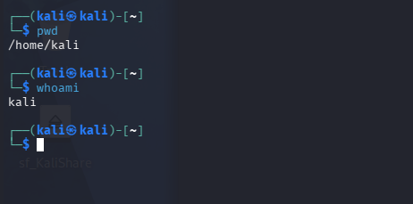

### Linux Directories

I practiced navigating and creating directories using the following commands:

```bash
ls
mkdir module2-lab
cd module2-lab
pwd
```

These commands allowed me to list directory contents, create the `module2-lab` directory, navigate into the directory, and confirm my current working directory.

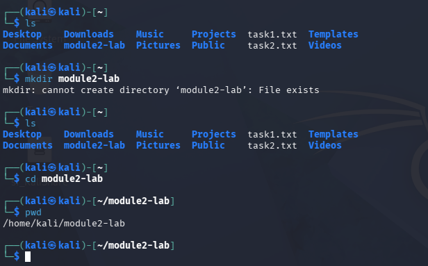

### Creating and Reading Files

I practiced creating, writing, and reading files using the following commands:

```bash
touch notes.txt
echo "Cybersecurity Module 2 Linux Lab" > notes.txt
cat notes.txt
ls -l
```

The `touch` command was used to create a file, `echo` was used to write text into the file, `cat` displayed the file contents, and `ls -l` displayed detailed information about the file.

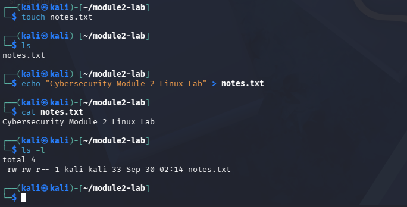
``

## 2. Linux Permissions and Security

### File Permissions

Linux permissions control which users can read, write, or execute files and directories.

I examined the permissions of `notes.txt` using:

```bash
ls -l
```

I then changed the permissions using:

```bash
chmod 640 notes.txt
```

The permission value `640` provided the following access:

- Owner: Read and Write
- Group: Read only
- Others: No access

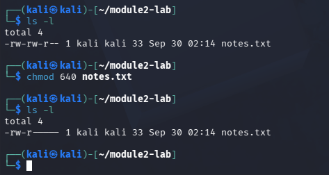


### Users, Groups and Processes

I used the following commands to examine user, group, and process information:

```bash
id
ps
```

The `id` command displayed my user ID, group ID, and group memberships. The `ps` command displayed processes associated with my current terminal session.

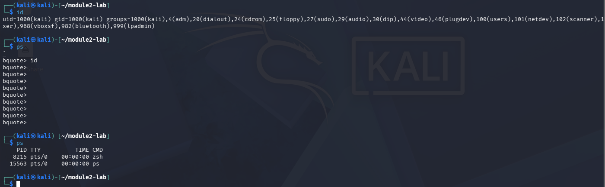


### Linux Security Basics

I used the following commands to examine file security information and group membership:

```bash
ls -l notes.txt
stat notes.txt
groups
```

The `stat` command confirmed that `notes.txt` had permissions of `0640`, while the `groups` command displayed the groups associated with my Kali Linux account.

This exercise demonstrated the importance of access control and the principle of least privilege, where users and processes should only receive the permissions required to perform their tasks.

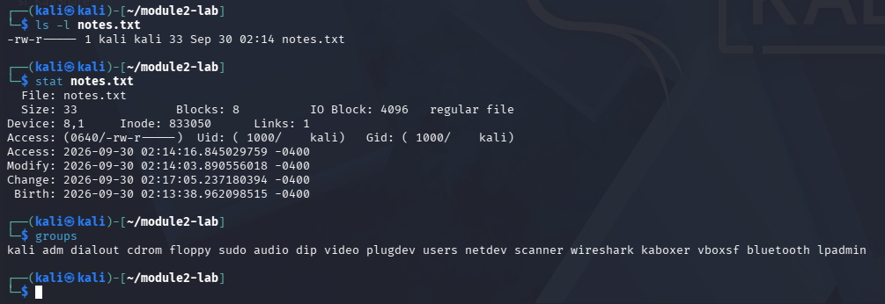

## 3. Reconnaissance and DNS Information Gathering

### Passive and Active Reconnaissance

Reconnaissance is the process of gathering information about systems, networks, or domains.

I learned the difference between two types of reconnaissance:

- **Passive reconnaissance** involves gathering publicly available information without directly probing the target system.
- **Active reconnaissance** involves directly interacting with a system or network to gather information.

All active reconnaissance activities in this module were performed within my controlled and authorized lab environment.

### Network Information

Before performing network enumeration, I identified the basic network configuration of my Kali Linux virtual machine using:

```bash
hostname
hostname -I
ip route
```

The results identified the following lab information:

- Hostname: `kali`
- Kali IPv4 Address: `10.0.0.2`
- Network: `10.0.0.0/24`
- Default Gateway: `10.0.0.1`
- Network Interface: `eth0`

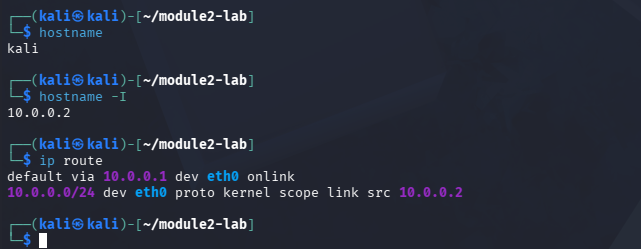


### DNS Information Gathering

I used the `dig` command to perform basic DNS information gathering using the example.com domain.

```bash
dig example.com
dig example.com +short
dig NS example.com +short
```

These commands demonstrated how DNS can be used to retrieve address records and name server information associated with a domain.

The activity helped me understand how DNS information can form part of the reconnaissance process.

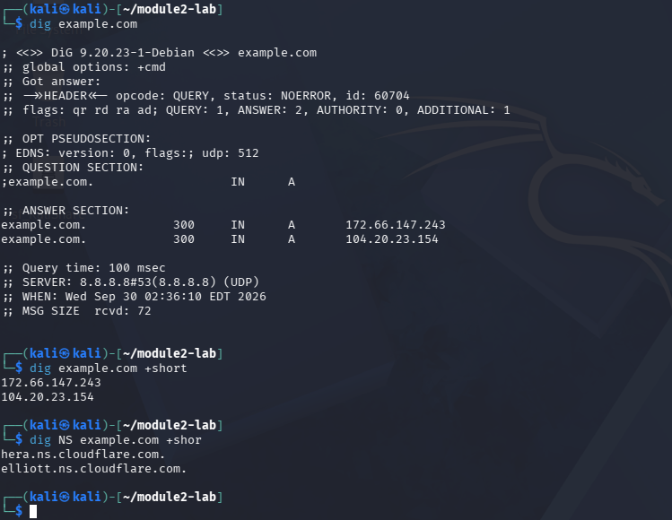


## 4. Nmap Network Enumeration

### Localhost Scan

I used Nmap to perform basic network enumeration within my controlled lab environment.

First, I confirmed the installed Nmap version and scanned the Kali Linux loopback address:

```bash
nmap --version
nmap 127.0.0.1
```

The localhost scan confirmed that the host was up. Nmap scanned its default 1,000 TCP ports and reported that the scanned ports were closed.

This demonstrated how Nmap can be used to determine host availability and examine TCP port states.

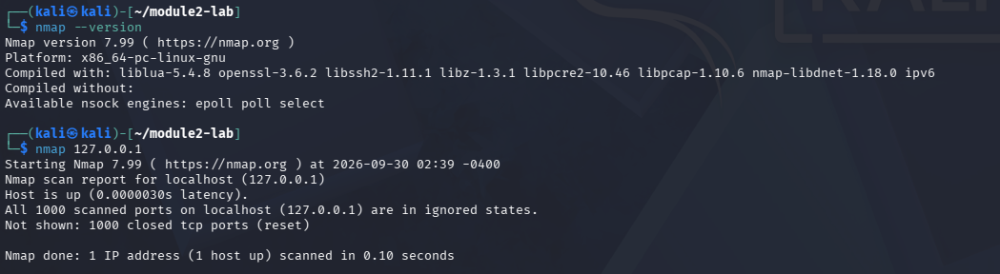


### Lab Gateway Enumeration

I then performed host discovery against the default gateway identified earlier in my controlled virtual network:

```bash
nmap -sn 10.0.0.1
```

I followed this with a standard Nmap scan:

```bash
nmap 10.0.0.1
```

The scan identified the gateway as active and reported the following open TCP ports:

- Port `135/tcp` - Nmap identified the service as `msrpc`
- Port `445/tcp` - Nmap identified the service as `microsoft-ds`

The remaining 998 ports in the default scan were reported as filtered with no response.

No further probing or exploitation of the identified services was performed. The activity was limited to basic enumeration within the controlled lab environment.

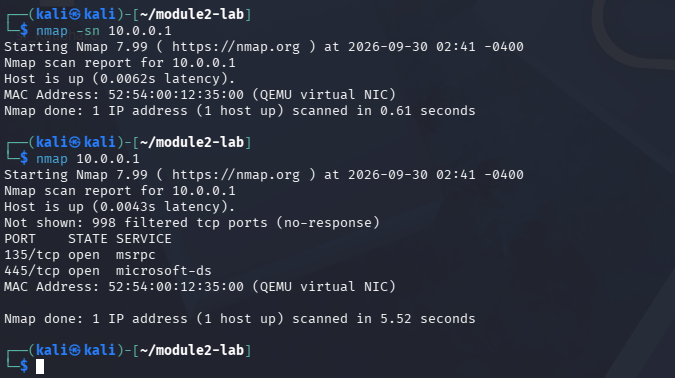

### What I Learned

This activity helped me understand the difference between host discovery and port scanning. I also learned how Nmap reports port states and associates common service names with discovered ports.


## 5. Wireshark Traffic Analysis

### Network Interface Selection

I used Wireshark to capture and analyze network traffic from my Kali Linux virtual machine.

The `eth0` network interface was selected because it was the active interface associated with the Kali Linux IP address `10.0.0.2`.

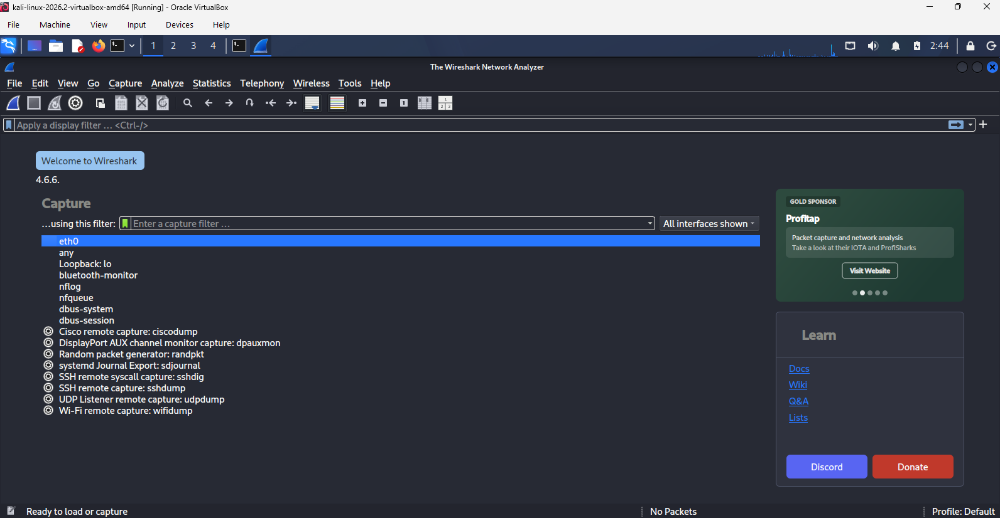


### ICMP Traffic Capture

To generate traffic for analysis, I performed a connectivity test between the Kali Linux virtual machine and the controlled lab gateway:

```bash
ping -c 4 10.0.0.1
```

Wireshark captured the traffic generated by the ping command.

I then applied the following Wireshark display filter:

```text
icmp
```

The filtered capture showed ICMP Echo Requests being sent from the Kali Linux machine at `10.0.0.2` to the gateway at `10.0.0.1`, followed by ICMP Echo Replies from the gateway.

The capture demonstrated the following communication:

```text
10.0.0.2 → 10.0.0.1
ICMP Echo Request

10.0.0.1 → 10.0.0.2
ICMP Echo Reply
```
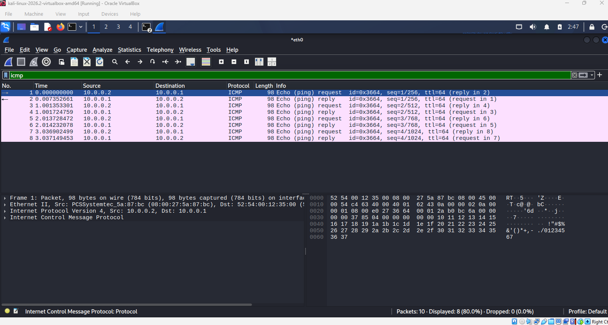

### What I Learned

This exercise demonstrated how Wireshark can be used to capture, filter, and inspect network traffic. I learned how source and destination IP addresses, protocols, and packet information can be analyzed to better understand communication between network devices.

## 6. Burp Suite Web Traffic Analysis

### Burp Suite Interface

I used Burp Suite Community Edition to gain introductory experience with web proxy and HTTP traffic analysis.

I created a temporary Burp Suite project and explored the main interface, including the Proxy and HTTP History features.

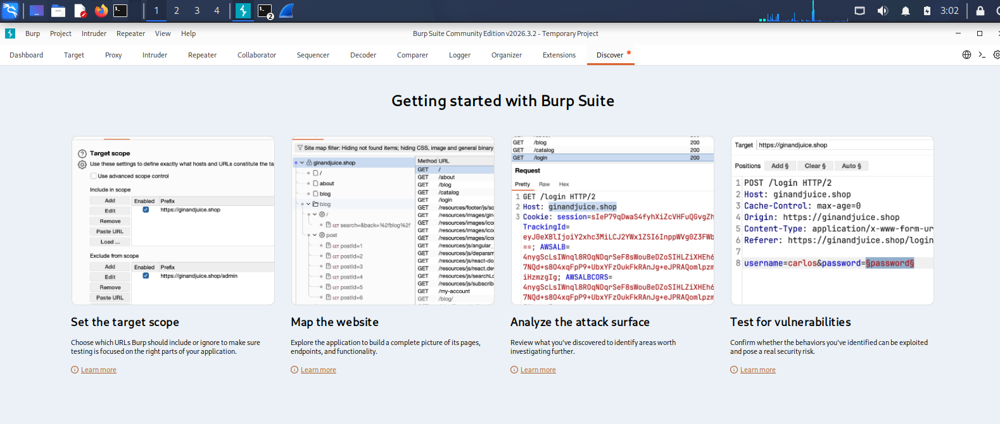


### HTTP Request Analysis

I used Burp Suite's built-in browser to access the Example Domain through the Burp proxy.

The HTTP History showed a web request with the following information:

- HTTP Method: `GET`
- Host: `example.com`
- URL: `/`
- HTTP Status Code: `200`
- Content Type: HTML

The activity demonstrated how a web proxy can observe HTTP requests and responses between a browser and a web server.

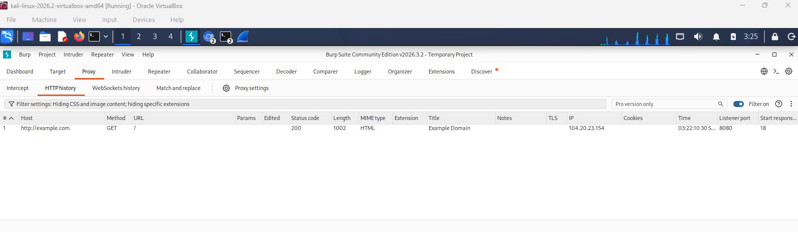

### What I Learned

This exercise helped me understand the basic role of Burp Suite as an intercepting web proxy. I learned how HTTP requests can be viewed and analyzed, including the request method, destination host, URL, and response status code.

No exploitation or unauthorized testing was performed during this activity.

## 7. OWASP ZAP Web Traffic Analysis

### OWASP ZAP Interface

I installed and launched OWASP ZAP in my Kali Linux laboratory environment.

I explored the ZAP interface and learned that it can operate as a web proxy for observing HTTP communication between a browser and a web server.

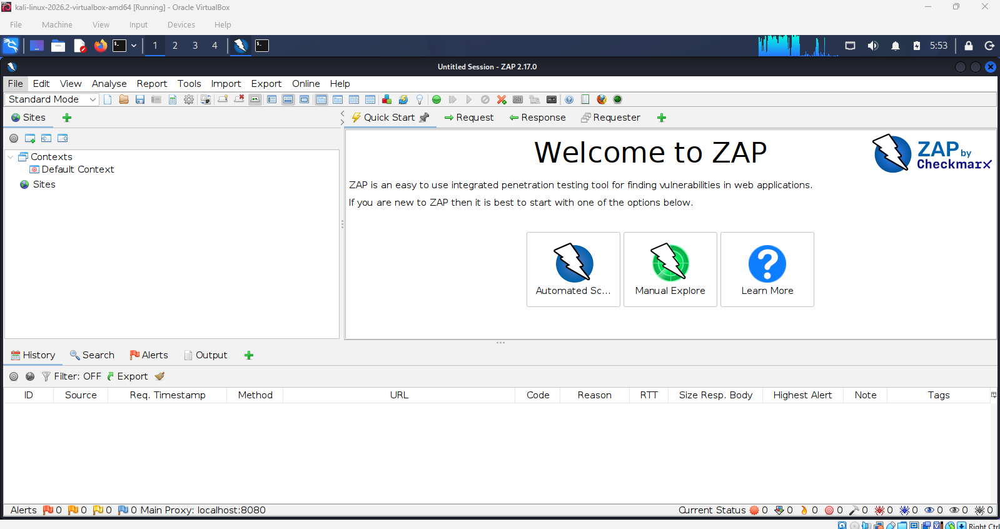

### HTTP Traffic Through ZAP

During the practical exercise, I configured Firefox to use the local OWASP ZAP proxy:

```text
Proxy Address: 127.0.0.1
Port: 8080
```

I then accessed:

```text
http://example.com
```

ZAP recorded the HTTP traffic in the History section.

The captured request showed:

- HTTP Method: `GET`
- URL: `http://example.com/`
- HTTP Status Code: `200`
- Response: `OK`

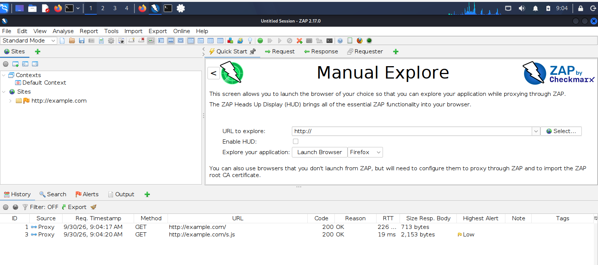


### What I Learned

This exercise helped me understand how OWASP ZAP can act as a proxy between a browser and web server, allowing HTTP requests and responses to be observed and analyzed.

The activity was limited to basic traffic observation for learning purposes. No automated attacks or unauthorized vulnerability testing were performed.

## 8. Controlled Reconnaissance Lab

### Lab Objective

The objective of the controlled reconnaissance lab was to apply Linux, networking, reconnaissance, and security-tool concepts in a safe and authorized virtual environment.

The lab focused on gathering network information, performing basic network enumeration, analyzing network traffic, and observing HTTP communication.

### Lab Environment

The practical activities were performed using a Kali Linux virtual machine.

The main network information identified during the lab was:

- Hostname: `kali`
- Network Interface: `eth0`
- Kali IPv4 Address: `10.0.0.2`
- Network: `10.0.0.0/24`
- Default Gateway: `10.0.0.1`

### Tools Used

The controlled lab included practical experience with:

- Kali Linux
- Nmap
- Wireshark
- Burp Suite Community Edition
- OWASP ZAP
- Firefox

### Reconnaissance Workflow

The lab followed a structured workflow:

1. Identified the Kali Linux host and network configuration.
2. Gathered basic DNS information using `dig`.
3. Performed controlled host discovery and port enumeration using Nmap.
4. Captured and analyzed ICMP traffic using Wireshark.
5. Observed HTTP requests using Burp Suite.
6. Configured Firefox to proxy HTTP traffic through OWASP ZAP.
7. Documented the commands, screenshots, and findings.

## 9. Key Findings

### Linux Security

Linux file permissions were used to control access to files.

The `notes.txt` file was configured with permissions of:

```text
-rw-r-----
```

This represented:

- Owner: Read and Write
- Group: Read
- Others: No access

### Network Configuration

The Kali Linux virtual machine used the IPv4 address `10.0.0.2` on interface `eth0`, with `10.0.0.1` configured as the default gateway.

### Nmap Findings

A scan of the local Kali loopback interface did not identify open ports among the default 1,000 scanned TCP ports.

The controlled gateway enumeration identified:

```text
135/tcp   open   msrpc
445/tcp   open   microsoft-ds
```

No additional probing or exploitation of these services was performed.

### Wireshark Findings

Wireshark captured ICMP traffic between:

```text
10.0.0.2
```

and:

```text
10.0.0.1
```

The packet capture demonstrated successful ICMP Echo Request and Echo Reply communication.

### Web Proxy Analysis

Burp Suite and OWASP ZAP were used to observe HTTP communication involving the Example Domain.

Both exercises demonstrated how HTTP requests and responses can be inspected through a web proxy.

## 10. Security Considerations

All active reconnaissance and network-enumeration activities were limited to my controlled virtual laboratory environment.

The practical exercises were performed for educational purposes and did not involve unauthorized scanning, exploitation, or vulnerability testing against third-party systems.

This module reinforced the importance of obtaining authorization before performing active cybersecurity testing.

## 11. Lessons Learned

During Module 2, I strengthened my understanding of Linux administration and cybersecurity fundamentals.

I gained practical experience with:

- Linux file and directory management
- File permissions and access control
- Users, groups, and processes
- Linux security basics
- Passive and active reconnaissance
- DNS information gathering
- Network enumeration
- Nmap port scanning
- Wireshark packet analysis
- Burp Suite HTTP traffic analysis
- OWASP ZAP proxy configuration and HTTP traffic observation

One of the most valuable lessons from this module was understanding how networking knowledge connects directly with cybersecurity.

Tools such as Nmap and Wireshark provided visibility into network communication, while Burp Suite and OWASP ZAP demonstrated how web traffic can be examined through a proxy.

## 12. Conclusion

Module 2 provided practical experience with Linux, reconnaissance, network analysis, and introductory cybersecurity tools.

The controlled lab allowed me to move beyond theoretical concepts and apply Linux commands, network enumeration, packet analysis, and HTTP traffic inspection in a safe virtual environment.

The activities strengthened my understanding of how cybersecurity professionals gather and analyze technical information while maintaining clear authorization and scope boundaries.

These skills provide a strong foundation for more advanced cybersecurity activities throughout the internship.